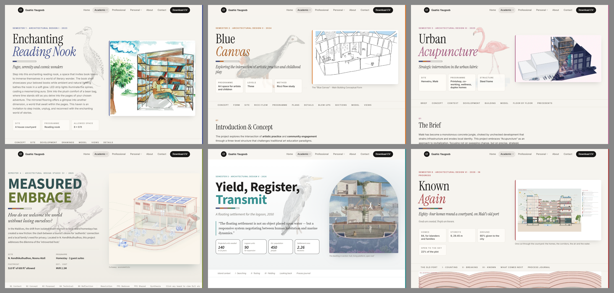

# Semester pages against the manifesto

_Audit of 25 October 2026, Astro 7 build, every semester page at 375 and 1280 px, measured in
the browser (font sizes, contrast, tap targets, alt text, headings) and looked at side by side.
This is Phase 0 of [DESIGN-PLAN.md](../DESIGN-PLAN.md) for the semester pages._

[All six pages at the same scale](semester-pages.png)

## The short version

Side by side the semester pages read as three sites: the kit (Sem 1–3, 6), the research book
(Sem 4) and the Design V boards (Sem 5). Most problems are shared, so they're fixed in passes
across every page rather than page by page. The biggest gap isn't visual: Sem 1–3 show the work
but don't tell its story, and that needs reflection only the author can write.

## 1. Two pages left the shell (P3)

| | Sem 1–3, 6 | Sem 4 | Sem 5 |
|---|---|---|---|
| Built from the kit (`.pk`) | yes | no, `me-hero` | no, `yr-hero` |
| Title | serif, one word italic in colour | heavy uppercase sans, two colours | bold sans, last word in colour |
| Font sizes in `main` | 8–14 | 22 | 17 |
| Facts | boxed tiles | label rows with rules | boxed tiles, large numbers |
| Chapter nav | uppercase chips | mono "01 Context" | italic sentence case |
| Ground | paper | paper | white |
| Lead image | rectangle, semester-colour edge | no edge | arched |

`DESIGN.md` §08 lets a voice change type, paper and colour, not the hero, facts or chapter nav.
Decision 2 in the plan settles whether Sem 4 and 5 move onto the shared parts (recommended) or
the rule changes.

## 2. The hero is a different shape on every page (P2, P3)

| | Sub-line | Intro | Facts | Lead caption |
|---|---|---|---|---|
| Sem 1 | yes | 106 words, runs under the bird | 3 | no |
| Sem 2 | yes | none | 3 | title case, in quotes |
| Sem 3 | yes | none | 3 | no; image on a pink tint |
| Sem 4 | a question | ~60 words | 4 | yes |
| Sem 5 | yes, plus a pull quote | none | 4 | yes |
| Sem 6 | yes, plus a line | none | 4 | yes |

One shape: sub-line → intro of 40 words or fewer (optional) → 3–4 facts → lead image on white,
with a caption.

## 3. The early semesters don't tell their story (P4)

| | Length | Words | First person | Ends with a reflection |
|---|---|---|---|---|
| Sem 1 | 9,300 px | 415 | 1 | no |
| Sem 2 | 12,200 px | 412 | 0 | no |
| Sem 3 | 12,600 px | 366 | 0 | no |
| Sem 4 | 34,000 px | 3,351 | 12 | yes |
| Sem 5 | 17,300 px | 2,582 | 11 | "Looking back" |
| Sem 6 | 22,700 px | 1,510 | 19 | "What comes next" |

Sem 5 and 6 are told in acts (context → searching → testing → yielding → looking back). Sem 1–3
are lists of drawing types with no "I" and no reflection; Sem 1's text addresses the reader
("your beloved books"). Sem 4 is the opposite: 26 headings and 40 boards, 3.6× Sem 1.

**Proposed chapter shape for every semester:** context → the idea → how it developed → the
drawings → looking back (what worked, what I'd change, what it led to next).

Questions to answer for each semester before writing:

- What was the brief really asking, and what did I decide it was about?
- What changed my mind during the project?
- Which drawing best shows the idea, and why?
- What would I do differently now?
- What did it teach me that shows up in the next semester?

## 4. Wording (P4)

- Title-case headings: Sem 1 4, Sem 2 11, Sem 3 13, Sem 4 24, Sem 5 12, Sem 6 1.
- Title-case captions: Sem 4 33 of 40 (Sem 5 0, Sem 6 3 are the model).
- Sem 4's numbered headings read as one word to screen readers: "01.0Project Abstract".
- Alt text that names instead of describes: Sem 2 18 of 23, Sem 3 21 of 24, Sem 1 10 of 17
  ("Problem Factor Diagram", "Section X-X"). Sem 5 and 6 have empty alts to check.
- Group work is marked only on Sem 6.
- Sem 1 typos: "a world that await", "wooden compliments"; inside images, "8ftx 8ft",
  "PROPETY". Meta description says "cozy".

## 5. Contrast and phones (P5)

- Contrast failures, all in voice pages: Sem 4 section numbers 3.3:1; Sem 5 roman numerals 4.0:1
  and labels such as "01 — a thousand years" 2.8:1; Sem 6 "How the book was made" 2.7:1.
- Drawing sets at 375 px: Sem 1 and 6 drop to ~160 px wide; the rest stay full width.
- Tap targets under 44 px: every link and button in `main` on Sem 1–4; about half on Sem 5–6.
- Sem 1's chapter nav runs 662 px in 335 with no hint more chips exist.

## 6. Already consistent (P2)

Kicker format, progress bar, semester colour and page edge on every page; a bird on Sem 1–5
(Sem 6 to choose). Bird placement varies: on Sem 1 it runs 105 px into the intro.

## Passes

1. **Text, all pages, one PR:** sentence case, Sem 4 heading spacing, real alt text, typos,
   group-work tags. No decisions needed.
2. **CSS, all pages:** contrast on Sem 4–6, drawing sets one column on phones, 44 px targets,
   chapter nav fade. No decisions needed.
3. **Structure:** one shared hero, facts, lead image, chapter nav and caption; Sem 4 and 5 keep
   their type and colour. Needs decision 2.
4. **Story, written by the author:** the chapter shape above, a first-person account and a
   "Looking back" for Sem 1–3, Sem 4 cut to its strongest boards, every intro under 40 words.
